```mermaid
flowchart TD
  v1_11_0["1.11.0<br/>v4.12-v4.15"]
  v1_12_0_rc1["1.12.0-rc1"]:::removed
  v1_12_0["1.12.0<br/>v4.12-v4.16"]
  v1_13_0_rc1["1.13.0-rc1"]:::removed
  v1_13_0["1.13.0<br/>v4.12-v4.16"]
  v1_14_0_rc1["1.14.0-rc1<br/>v4.17"]
  v1_14_0_rc2["1.14.0-rc2<br/>v4.17"]
  v1_14_0["1.14.0<br/>v4.17"]
  v1_14_1["1.14.1<br/>v4.17"]
  v1_14_2["1.14.2<br/>v4.17"]
  v1_14_3["1.14.3<br/>v4.12-v4.17"]
  v1_15_0_rc1["1.15.0-rc1<br/>v4.17"]
  v1_15_0_rc2["1.15.0-rc2<br/>v4.17"]
  v1_15_0_rc3["1.15.0-rc3<br/>v4.17"]
  v1_15_0_rc4["1.15.0-rc4<br/>v4.17"]
  v1_15_0["1.15.0<br/>v4.17"]
  v1_15_1["1.15.1<br/>v4.17"]
  v1_15_2["1.15.2<br/>v4.12-v4.17"]
  v1_16_0_rc1["1.16.0-rc1<br/>v4.17"]
  v1_16_0_rc2["1.16.0-rc2<br/>v4.17"]
  v1_16_0_rc3["1.16.0-rc3<br/>v4.17"]
  v1_16_0["1.16.0<br/>v4.17"]
  v1_16_1["1.16.1<br/>v4.17"]
  v1_16_2["1.16.2<br/>v4.17"]
  v1_16_3["1.16.3<br/>v4.12-v4.17"]
  v1_17_0_rc1["1.17.0-rc1<br/>v4.17-v4.19"]
  v1_17_0["1.17.0<br/>v4.17-v4.19"]
  v1_17_1["1.17.1<br/>v4.17-v4.19"]
  v1_17_2["1.17.2<br/>v4.17-v4.19"]
  v1_17_3["1.17.3<br/>v4.17-v4.19"]
  v1_17_4["1.17.4<br/>v4.12-v4.19"]
  v1_18_0_rc1["1.18.0-rc1<br/>v4.17-v4.19"]
  v1_18_0_rc2["1.18.0-rc2<br/>v4.17-v4.19"]
  v1_18_0_rc3["1.18.0-rc3<br/>v4.17-v4.19"]
  v1_18_0_rc4["1.18.0-rc4<br/>v4.17-v4.19"]
  v1_18_0["1.18.0<br/>v4.17-v4.19"]
  v1_18_1["1.18.1<br/>v4.17-v4.20"]
  v1_18_2["1.18.2<br/>v4.17-v4.20"]
  v1_18_3["1.18.3<br/>v4.17-v4.20"]
  v1_18_4["1.18.4<br/>v4.17-v4.20"]
  v1_18_5["1.18.5<br/>v4.17-v4.20"]
  v1_18_6["1.18.6<br/>v4.17-v4.20"]
  v1_18_7["1.18.7<br/>v4.17-v4.21"]
  v1_18_8["1.18.8"]
  v1_19_0_rc1["1.19.0-rc1"]
  v1_19_0_rc2["1.19.0-rc2"]
  v1_19_0_rc3["1.19.0-rc3"]
  v1_19_0_rc4["1.19.0-rc4"]
  v1_19_0_rc5["1.19.0-rc5"]
  v1_19_0["1.19.0"]
  v1_19_1["1.19.1"]
  v1_19_2["1.19.2"]
  v1_19_3["1.19.3"]:::head
  v1_11_0 --> |"v4.12-v4.15"| v1_12_0
  v1_12_0_rc1 -.-> |"v4.12-v4.16"| v1_12_0
  v1_12_0 --> |"v4.12-v4.16"| v1_13_0
  v1_13_0_rc1 -.-> |"v4.12-v4.16"| v1_13_0
  v1_14_0_rc1 --> |"v4.17"| v1_14_0_rc2
  v1_14_0_rc2 --> |"v4.17"| v1_14_0
  v1_14_0 --> |"v4.17"| v1_14_1
  v1_14_1 --> |"v4.17"| v1_14_2
  v1_13_0 --> |"v4.12-v4.16"| v1_14_3
  v1_14_0_rc1 -.-> |"v4.12-v4.16"| v1_14_3
  v1_14_0_rc2 -.-> |"v4.12-v4.16"| v1_14_3
  v1_14_0 -.-> |"v4.12-v4.16"| v1_14_3
  v1_14_1 -.-> |"v4.12-v4.16"| v1_14_3
  v1_14_2 --> |"v4.17"| v1_14_3
  v1_14_2 -.-> |"v4.12-v4.16"| v1_14_3
  v1_14_3 --> |"v4.17"| v1_15_0_rc1
  v1_15_0_rc1 --> |"v4.17"| v1_15_0_rc2
  v1_15_0_rc2 --> |"v4.17"| v1_15_0_rc3
  v1_15_0_rc3 --> |"v4.17"| v1_15_0_rc4
  v1_15_0_rc4 --> |"v4.17"| v1_15_0
  v1_15_0 --> |"v4.17"| v1_15_1
  v1_14_3 --> |"v4.12-v4.16"| v1_15_2
  v1_15_0_rc1 -.-> |"v4.12-v4.16"| v1_15_2
  v1_15_0_rc2 -.-> |"v4.12-v4.16"| v1_15_2
  v1_15_0_rc3 -.-> |"v4.12-v4.16"| v1_15_2
  v1_15_0_rc4 -.-> |"v4.12-v4.16"| v1_15_2
  v1_15_0 -.-> |"v4.12-v4.16"| v1_15_2
  v1_15_1 --> |"v4.17"| v1_15_2
  v1_15_1 -.-> |"v4.12-v4.16"| v1_15_2
  v1_15_2 --> |"v4.17"| v1_16_0_rc1
  v1_16_0_rc1 --> |"v4.17"| v1_16_0_rc2
  v1_16_0_rc2 --> |"v4.17"| v1_16_0_rc3
  v1_16_0_rc3 --> |"v4.17"| v1_16_0
  v1_16_0 --> |"v4.17"| v1_16_1
  v1_16_1 --> |"v4.17"| v1_16_2
  v1_15_2 --> |"v4.12-v4.16"| v1_16_3
  v1_16_0_rc1 -.-> |"v4.12-v4.16"| v1_16_3
  v1_16_0_rc2 -.-> |"v4.12-v4.16"| v1_16_3
  v1_16_0_rc3 -.-> |"v4.12-v4.16"| v1_16_3
  v1_16_0 -.-> |"v4.12-v4.16"| v1_16_3
  v1_16_1 -.-> |"v4.12-v4.16"| v1_16_3
  v1_16_2 --> |"v4.17"| v1_16_3
  v1_16_2 -.-> |"v4.12-v4.16"| v1_16_3
  v1_16_3 --> |"v4.17"| v1_17_0_rc1
  v1_17_0_rc1 --> |"v4.17-v4.19"| v1_17_0
  v1_17_0 --> |"v4.17-v4.19"| v1_17_1
  v1_17_1 --> |"v4.17-v4.19"| v1_17_2
  v1_17_2 --> |"v4.17-v4.19"| v1_17_3
  v1_16_3 --> |"v4.12-v4.16"| v1_17_4
  v1_17_0_rc1 -.-> |"v4.12-v4.16"| v1_17_4
  v1_17_0 -.-> |"v4.12-v4.16"| v1_17_4
  v1_17_1 -.-> |"v4.12-v4.16"| v1_17_4
  v1_17_2 -.-> |"v4.12-v4.16"| v1_17_4
  v1_17_3 --> |"v4.17-v4.19"| v1_17_4
  v1_17_3 -.-> |"v4.12-v4.16"| v1_17_4
  v1_17_4 --> |"v4.17-v4.19"| v1_18_0_rc1
  v1_18_0_rc1 --> |"v4.17-v4.19"| v1_18_0_rc2
  v1_18_0_rc2 --> |"v4.17-v4.19"| v1_18_0_rc3
  v1_18_0_rc3 --> |"v4.17-v4.19"| v1_18_0_rc4
  v1_18_0_rc4 --> |"v4.17-v4.19"| v1_18_0
  v1_18_0 --> |"v4.17-v4.19"| v1_18_1
  v1_18_1 --> |"v4.17-v4.20"| v1_18_2
  v1_18_2 --> |"v4.17-v4.20"| v1_18_3
  v1_18_3 --> |"v4.17-v4.20"| v1_18_4
  v1_18_4 --> |"v4.17-v4.20"| v1_18_5
  v1_18_5 --> |"v4.17-v4.20"| v1_18_6
  v1_18_6 --> |"v4.17-v4.20"| v1_18_7
  v1_17_4 --> |"v4.12-v4.16"| v1_18_8
  v1_18_0_rc1 -.-> |"v4.12-v4.16"| v1_18_8
  v1_18_0_rc2 -.-> |"v4.12-v4.16"| v1_18_8
  v1_18_0_rc3 -.-> |"v4.12-v4.16"| v1_18_8
  v1_18_0_rc4 -.-> |"v4.12-v4.16"| v1_18_8
  v1_18_0 -.-> |"v4.12-v4.16"| v1_18_8
  v1_18_1 -.-> |"v4.12-v4.16"| v1_18_8
  v1_18_2 -.-> |"v4.12-v4.16"| v1_18_8
  v1_18_3 -.-> |"v4.12-v4.16"| v1_18_8
  v1_18_4 -.-> |"v4.12-v4.16"| v1_18_8
  v1_18_5 -.-> |"v4.12-v4.16"| v1_18_8
  v1_18_6 -.-> |"v4.12-v4.16"| v1_18_8
  v1_18_7 --> |"v4.17-v4.21"| v1_18_8
  v1_18_7 -.-> |"v4.12-v4.16"| v1_18_8
  v1_18_8 --> v1_19_0_rc1
  v1_19_0_rc1 --> v1_19_0_rc2
  v1_19_0_rc2 --> v1_19_0_rc3
  v1_19_0_rc3 --> v1_19_0_rc4
  v1_19_0_rc4 --> v1_19_0_rc5
  v1_19_0_rc5 --> v1_19_0
  v1_19_0 --> v1_19_1
  v1_19_1 --> v1_19_2
  v1_19_2 --> v1_19_3
  classDef head stroke-width:3px
  classDef removed stroke-dasharray:4 4,color:#888
```

```mermaid
flowchart TD
  v1_11_0["1.11.0<br/>v4.12-v4.15"]
  v1_12_0["1.12.0<br/>v4.12-v4.16"]
  v1_13_0["1.13.0<br/>v4.12-v4.16"]
  v1_14_0["1.14.0<br/>v4.17"]
  v1_14_1["1.14.1<br/>v4.17"]
  v1_14_2["1.14.2<br/>v4.17"]
  v1_14_3["1.14.3<br/>v4.12-v4.17"]
  v1_15_0["1.15.0<br/>v4.17"]
  v1_15_1["1.15.1<br/>v4.17"]
  v1_15_2["1.15.2<br/>v4.12-v4.17"]
  v1_16_0["1.16.0<br/>v4.17"]
  v1_16_1["1.16.1<br/>v4.17"]
  v1_16_2["1.16.2<br/>v4.17"]
  v1_16_3["1.16.3<br/>v4.12-v4.17"]
  v1_17_0["1.17.0<br/>v4.17-v4.19"]
  v1_17_1["1.17.1<br/>v4.17-v4.19"]
  v1_17_2["1.17.2<br/>v4.17-v4.19"]
  v1_17_3["1.17.3<br/>v4.17-v4.19"]
  v1_17_4["1.17.4<br/>v4.12-v4.19"]
  v1_18_0["1.18.0<br/>v4.17-v4.19"]
  v1_18_1["1.18.1<br/>v4.17-v4.20"]
  v1_18_2["1.18.2<br/>v4.17-v4.20"]
  v1_18_3["1.18.3<br/>v4.17-v4.20"]
  v1_18_4["1.18.4<br/>v4.17-v4.20"]
  v1_18_5["1.18.5<br/>v4.17-v4.20"]
  v1_18_6["1.18.6<br/>v4.17-v4.20"]
  v1_18_7["1.18.7<br/>v4.17-v4.21"]
  v1_18_8["1.18.8"]
  v1_19_0["1.19.0"]
  v1_19_1["1.19.1"]
  v1_19_2["1.19.2"]
  v1_19_3["1.19.3"]:::head
  v1_11_0 --> |"v4.12-v4.15"| v1_12_0
  v1_12_0 --> |"v4.12-v4.16"| v1_13_0
  v1_14_0 --> |"v4.17"| v1_14_1
  v1_14_1 --> |"v4.17"| v1_14_2
  v1_13_0 --> |"v4.12-v4.16"| v1_14_3
  v1_14_0 -.-> |"v4.12-v4.16"| v1_14_3
  v1_14_1 -.-> |"v4.12-v4.16"| v1_14_3
  v1_14_2 --> |"v4.17"| v1_14_3
  v1_14_2 -.-> |"v4.12-v4.16"| v1_14_3
  v1_14_3 --> |"v4.17"| v1_15_0
  v1_15_0 --> |"v4.17"| v1_15_1
  v1_14_3 --> |"v4.12-v4.16"| v1_15_2
  v1_15_0 -.-> |"v4.12-v4.16"| v1_15_2
  v1_15_1 --> |"v4.17"| v1_15_2
  v1_15_1 -.-> |"v4.12-v4.16"| v1_15_2
  v1_15_2 --> |"v4.17"| v1_16_0
  v1_16_0 --> |"v4.17"| v1_16_1
  v1_16_1 --> |"v4.17"| v1_16_2
  v1_15_2 --> |"v4.12-v4.16"| v1_16_3
  v1_16_0 -.-> |"v4.12-v4.16"| v1_16_3
  v1_16_1 -.-> |"v4.12-v4.16"| v1_16_3
  v1_16_2 --> |"v4.17"| v1_16_3
  v1_16_2 -.-> |"v4.12-v4.16"| v1_16_3
  v1_16_3 --> |"v4.17"| v1_17_0
  v1_17_0 --> |"v4.17-v4.19"| v1_17_1
  v1_17_1 --> |"v4.17-v4.19"| v1_17_2
  v1_17_2 --> |"v4.17-v4.19"| v1_17_3
  v1_16_3 --> |"v4.12-v4.16"| v1_17_4
  v1_17_0 -.-> |"v4.12-v4.16"| v1_17_4
  v1_17_1 -.-> |"v4.12-v4.16"| v1_17_4
  v1_17_2 -.-> |"v4.12-v4.16"| v1_17_4
  v1_17_3 --> |"v4.17-v4.19"| v1_17_4
  v1_17_3 -.-> |"v4.12-v4.16"| v1_17_4
  v1_17_4 --> |"v4.17-v4.19"| v1_18_0
  v1_18_0 --> |"v4.17-v4.19"| v1_18_1
  v1_18_1 --> |"v4.17-v4.20"| v1_18_2
  v1_18_2 --> |"v4.17-v4.20"| v1_18_3
  v1_18_3 --> |"v4.17-v4.20"| v1_18_4
  v1_18_4 --> |"v4.17-v4.20"| v1_18_5
  v1_18_5 --> |"v4.17-v4.20"| v1_18_6
  v1_18_6 --> |"v4.17-v4.20"| v1_18_7
  v1_17_4 --> |"v4.12-v4.16"| v1_18_8
  v1_18_0 -.-> |"v4.12-v4.16"| v1_18_8
  v1_18_1 -.-> |"v4.12-v4.16"| v1_18_8
  v1_18_2 -.-> |"v4.12-v4.16"| v1_18_8
  v1_18_3 -.-> |"v4.12-v4.16"| v1_18_8
  v1_18_4 -.-> |"v4.12-v4.16"| v1_18_8
  v1_18_5 -.-> |"v4.12-v4.16"| v1_18_8
  v1_18_6 -.-> |"v4.12-v4.16"| v1_18_8
  v1_18_7 --> |"v4.17-v4.21"| v1_18_8
  v1_18_7 -.-> |"v4.12-v4.16"| v1_18_8
  v1_18_8 --> v1_19_0
  v1_19_0 --> v1_19_1
  v1_19_1 --> v1_19_2
  v1_19_2 --> v1_19_3
  classDef head stroke-width:3px
  classDef removed stroke-dasharray:4 4,color:#888
```

# Red Hat Community versions

Update graph of each channel of operator `stackgres-community` in [Red Hat Community](https://github.com/redhat-openshift-ecosystem/community-operators-prod),
generated by `versions-of-red-hat-community.sh` from the file-based catalog templates in `operators/stackgres-community/catalog-templates` at commit
`a3e5e68fa (2026-10-15)`.

Default channel: `stable`

A solid arrow goes from a version to the one that replaces it, a dotted arrow from a
version to one that skips it. The heads of a channel have a thick border, and versions
that are only skipped, since they are no longer in the catalog, a dashed one.
A version or an arrow that is not in every OCP catalog is labeled with the catalogs it is in.
Versions no longer in the catalog can not be installed, but clusters running them are still
upgraded through the skips of the version that replaced them.

## Channel `candidate`

Head: `1.19.3`

Versions offered to install by the OpenShift Web Console, newest first (the default one in bold):

| OCP catalogs | Versions |
| --- | --- |
| v4.12-v4.15 | **1.19.3**, 1.19.2, 1.19.1, 1.19.0, 1.19.0-rc5, 1.19.0-rc4, 1.19.0-rc3, 1.19.0-rc2, 1.19.0-rc1, 1.18.8, 1.17.4, 1.16.3, 1.15.2, 1.14.3, 1.13.0, 1.12.0, 1.11.0 |
| v4.16 | **1.19.3**, 1.19.2, 1.19.1, 1.19.0, 1.19.0-rc5, 1.19.0-rc4, 1.19.0-rc3, 1.19.0-rc2, 1.19.0-rc1, 1.18.8, 1.17.4, 1.16.3, 1.15.2, 1.14.3, 1.13.0, 1.12.0 |
| v4.17 | **1.19.3**, 1.19.2, 1.19.1, 1.19.0, 1.19.0-rc5, 1.19.0-rc4, 1.19.0-rc3, 1.19.0-rc2, 1.19.0-rc1, 1.18.8, 1.18.7, 1.18.6, 1.18.5, 1.18.4, 1.18.3, 1.18.2, 1.18.1, 1.18.0, 1.18.0-rc4, 1.18.0-rc3, 1.18.0-rc2, 1.18.0-rc1, 1.17.4, 1.17.3, 1.17.2, 1.17.1, 1.17.0, 1.17.0-rc1, 1.16.3, 1.16.2, 1.16.1, 1.16.0, 1.16.0-rc3, 1.16.0-rc2, 1.16.0-rc1, 1.15.2, 1.15.1, 1.15.0, 1.15.0-rc4, 1.15.0-rc3, 1.15.0-rc2, 1.15.0-rc1, 1.14.3, 1.14.2, 1.14.1, 1.14.0, 1.14.0-rc2, 1.14.0-rc1 |
| v4.18-v4.19 | **1.19.3**, 1.19.2, 1.19.1, 1.19.0, 1.19.0-rc5, 1.19.0-rc4, 1.19.0-rc3, 1.19.0-rc2, 1.19.0-rc1, 1.18.8, 1.18.7, 1.18.6, 1.18.5, 1.18.4, 1.18.3, 1.18.2, 1.18.1, 1.18.0, 1.18.0-rc4, 1.18.0-rc3, 1.18.0-rc2, 1.18.0-rc1, 1.17.4, 1.17.3, 1.17.2, 1.17.1, 1.17.0, 1.17.0-rc1 |
| v4.20 | **1.19.3**, 1.19.2, 1.19.1, 1.19.0, 1.19.0-rc5, 1.19.0-rc4, 1.19.0-rc3, 1.19.0-rc2, 1.19.0-rc1, 1.18.8, 1.18.7, 1.18.6, 1.18.5, 1.18.4, 1.18.3, 1.18.2, 1.18.1 |
| v4.21 | **1.19.3**, 1.19.2, 1.19.1, 1.19.0, 1.19.0-rc5, 1.19.0-rc4, 1.19.0-rc3, 1.19.0-rc2, 1.19.0-rc1, 1.18.8, 1.18.7 |

## Channel `fast`

Head: `1.19.3`

Versions offered to install by the OpenShift Web Console, newest first (the default one in bold):

| OCP catalogs | Versions |
| --- | --- |
| v4.12-v4.15 | **1.19.3**, 1.19.2, 1.19.1, 1.19.0, 1.19.0-rc5, 1.19.0-rc4, 1.19.0-rc3, 1.19.0-rc2, 1.19.0-rc1, 1.18.8, 1.17.4, 1.16.3, 1.15.2, 1.14.3, 1.13.0, 1.12.0, 1.11.0 |
| v4.16 | **1.19.3**, 1.19.2, 1.19.1, 1.19.0, 1.19.0-rc5, 1.19.0-rc4, 1.19.0-rc3, 1.19.0-rc2, 1.19.0-rc1, 1.18.8, 1.17.4, 1.16.3, 1.15.2, 1.14.3, 1.13.0, 1.12.0 |
| v4.17 | **1.19.3**, 1.19.2, 1.19.1, 1.19.0, 1.19.0-rc5, 1.19.0-rc4, 1.19.0-rc3, 1.19.0-rc2, 1.19.0-rc1, 1.18.8, 1.18.7, 1.18.6, 1.18.5, 1.18.4, 1.18.3, 1.18.2, 1.18.1, 1.18.0, 1.18.0-rc4, 1.18.0-rc3, 1.18.0-rc2, 1.18.0-rc1, 1.17.4, 1.17.3, 1.17.2, 1.17.1, 1.17.0, 1.17.0-rc1, 1.16.3, 1.16.2, 1.16.1, 1.16.0, 1.16.0-rc3, 1.16.0-rc2, 1.16.0-rc1, 1.15.2, 1.15.1, 1.15.0, 1.15.0-rc4, 1.15.0-rc3, 1.15.0-rc2, 1.15.0-rc1, 1.14.3, 1.14.2, 1.14.1, 1.14.0, 1.14.0-rc2, 1.14.0-rc1 |
| v4.18-v4.19 | **1.19.3**, 1.19.2, 1.19.1, 1.19.0, 1.19.0-rc5, 1.19.0-rc4, 1.19.0-rc3, 1.19.0-rc2, 1.19.0-rc1, 1.18.8, 1.18.7, 1.18.6, 1.18.5, 1.18.4, 1.18.3, 1.18.2, 1.18.1, 1.18.0, 1.18.0-rc4, 1.18.0-rc3, 1.18.0-rc2, 1.18.0-rc1, 1.17.4, 1.17.3, 1.17.2, 1.17.1, 1.17.0, 1.17.0-rc1 |
| v4.20 | **1.19.3**, 1.19.2, 1.19.1, 1.19.0, 1.19.0-rc5, 1.19.0-rc4, 1.19.0-rc3, 1.19.0-rc2, 1.19.0-rc1, 1.18.8, 1.18.7, 1.18.6, 1.18.5, 1.18.4, 1.18.3, 1.18.2, 1.18.1 |
| v4.21 | **1.19.3**, 1.19.2, 1.19.1, 1.19.0, 1.19.0-rc5, 1.19.0-rc4, 1.19.0-rc3, 1.19.0-rc2, 1.19.0-rc1, 1.18.8, 1.18.7 |

## Channel `stable`

Head: `1.19.3`

Versions offered to install by the OpenShift Web Console, newest first (the default one in bold):

| OCP catalogs | Versions |
| --- | --- |
| v4.12-v4.15 | **1.19.3**, 1.19.2, 1.19.1, 1.19.0, 1.18.8, 1.17.4, 1.16.3, 1.15.2, 1.14.3, 1.13.0, 1.12.0, 1.11.0 |
| v4.16 | **1.19.3**, 1.19.2, 1.19.1, 1.19.0, 1.18.8, 1.17.4, 1.16.3, 1.15.2, 1.14.3, 1.13.0, 1.12.0 |
| v4.17 | **1.19.3**, 1.19.2, 1.19.1, 1.19.0, 1.18.8, 1.18.7, 1.18.6, 1.18.5, 1.18.4, 1.18.3, 1.18.2, 1.18.1, 1.18.0, 1.17.4, 1.17.3, 1.17.2, 1.17.1, 1.17.0, 1.16.3, 1.16.2, 1.16.1, 1.16.0, 1.15.2, 1.15.1, 1.15.0, 1.14.3, 1.14.2, 1.14.1, 1.14.0 |
| v4.18-v4.19 | **1.19.3**, 1.19.2, 1.19.1, 1.19.0, 1.18.8, 1.18.7, 1.18.6, 1.18.5, 1.18.4, 1.18.3, 1.18.2, 1.18.1, 1.18.0, 1.17.4, 1.17.3, 1.17.2, 1.17.1, 1.17.0 |
| v4.20 | **1.19.3**, 1.19.2, 1.19.1, 1.19.0, 1.18.8, 1.18.7, 1.18.6, 1.18.5, 1.18.4, 1.18.3, 1.18.2, 1.18.1 |
| v4.21 | **1.19.3**, 1.19.2, 1.19.1, 1.19.0, 1.18.8, 1.18.7 |

